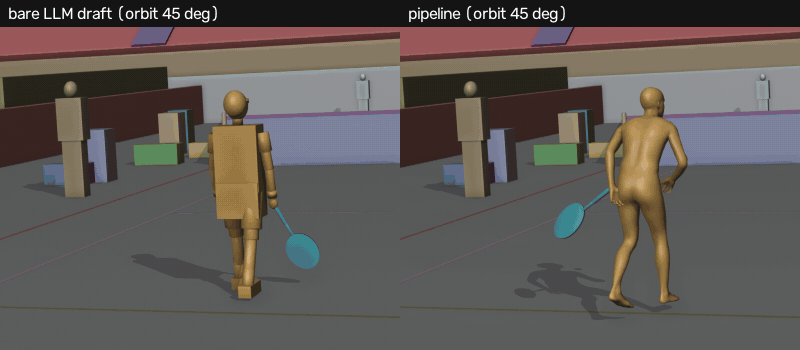
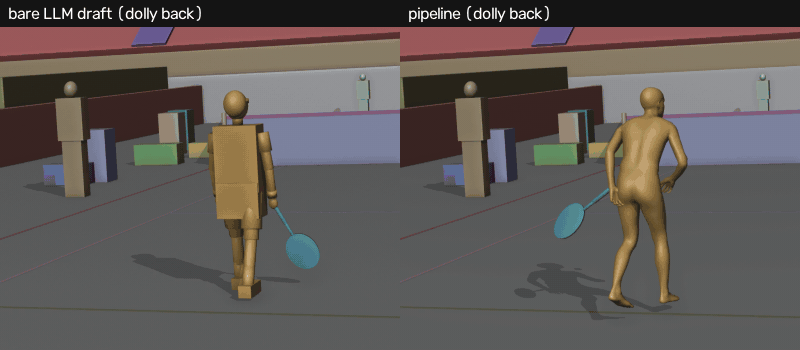
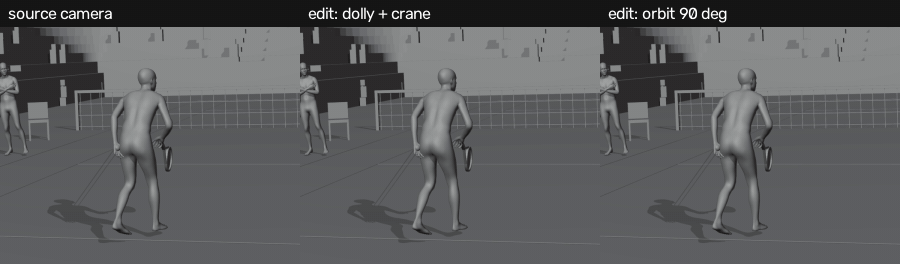

# Video-Reconstruction

Turn a short reference video into an **editable 3D scene in Blender**, edit it (camera, objects, timing), and use
the scene to steer a video generator (V2V) for the final look. Research, non-commercial.

The idea: a measured, editable 3D scene gives a generator structure it can follow (where the camera is, where people
and objects are, how they move), and edits made in the scene survive generation. A scene drafted by an LLM alone
looks plausible from the original camera but falls apart once the camera moves or the motion matters.

## Results: tennis case study

All pictures below are renders of our own Blender scenes. Source frames and generated videos are not shown here
(see [Data and licences](#data-and-licences)).

### Measured scene vs. a bare LLM draft

Same clip, same new camera path, same colour per object (people orange, held objects cyan). Left: the scene an LLM
built from the video alone. Right: the scene this pipeline built (measured camera, court, and the player's body
motion; the racket fitted to the observed racket in every frame).

| Orbit 45° around the player | Dolly back |
|---|---|
|  |  |

Overlap with the observed masks in the original camera view (median over 6 checked frames, `runs/p5/tennis/*/qc.json`):

| | bare LLM draft | pipeline |
|---|---|---|
| people | 0.50 | **0.67** |
| racket | 0.00 | **0.49** |
| ball | 0.00 | **0.21** |

After generation (MiniMax-H3, same references, prompt and seed), both versions look like real footage: the
generator fills the empty space the bare draft leaves when the camera turns. The difference that survives is
**motion**: with the measured body, the toss, the swing and the step match the source. The bare draft's mannequin
drags the generated player into a different motion (stooping, running forward).

### Camera edits on one scene

The scene stays the same; only the Blender camera changes. These clay renders were the structure input for
generation (`runs/pipeline/tennis_v2v`).



## How it works

```
video ─► observe ─────────────────────────► build scene ─► edit in Blender ─► render controls ─► V2V generation
         cuts, SAM 3.1 masks, 4RC camera      Blender .blend   camera, objects,   clay / depth /      MiniMax-H3 (r2v,
         and depth, GVHMR body motion,        (one world in    timing             labels (24 fps,     rented GPU)
         court/floor, props from masks        metres, Z up)                       /32 sizes)
```

- **Observe**: shot cuts, SAM 3.1 masks for people and objects, 4RC for camera and depth, GVHMR (and FAB for
  close-ups) for body motion, a floor/venue fit, held objects fitted to the observed masks.
- **Scene**: one Blender world per clip. The scene is the editable source; human edits and locked fields are never
  overwritten when the pipeline re-runs.
- **Checks**: renders are compared with the observed masks (people, objects, depth conflicts, floating or
  teleporting things), plus an optional image-reading judge.
- **Generation**: a clay render of the scene is the video input, crops of the source give the look.

## Status (2026-11-23)

- **v1.0 done (2026-11-19)**: the tennis case study above, and a 2×3 study on synthetic clips (`evaluation/RESULTS.md`).
- **In progress: multi-cut film clips.** One world for all cuts, close-ups placed against the same person, an AI
  agent that builds the set from measured evidence (`docs/DESIGN_v3.md`). Quality is not there yet (people's body
  proportions differ between cuts, set and props are rough); a design review is under way. No results from film
  clips are published.
- Details: [`docs/STATUS.md`](docs/STATUS.md). Plans: [`docs/PLAN_v2.md`](docs/PLAN_v2.md) (Japanese),
  [`docs/DESIGN_v3.md`](docs/DESIGN_v3.md) (Japanese), [`docs/ARCHITECTURE.md`](docs/ARCHITECTURE.md).

## Setup

Main machine: Windows 11, RTX 4060 Laptop (8 GB). Generation runs on a rented GPU.

```powershell
winget install --id=astral-sh.uv -e
winget install --id=Gyan.FFmpeg -e
uv venv --python 3.13 .venv
uv pip install --python .venv\Scripts\python.exe -e ".[blender,control,mcp,dev]"
.venv\Scripts\python.exe -m pytest -q
```

Linux: `bash scripts/setup.sh` (creates `.venv` with Python 3.13 and `bpy` 5.2.3, runs a render smoke test).
On Windows, bash scripts need Git Bash (plain `bash` in PowerShell starts WSL). The observation models (SAM 3.1,
4RC, GVHMR in WSL, FAB) live in separate environments under `%LOCALAPPDATA%/vrecon`.

Cycles uses the GPU when there is one (`VRECON_RENDER_DEVICE` = `auto`, `cpu`, `optix`, `cuda`).

## Usage

```bash
vrecon pipeline-scene evaluation/recipes/tennis/scene.json --check   # tennis: observation -> scene
vrecon pipeline-v2v   evaluation/recipes/tennis/v2v.json --server URL # controls, prompts, generation (ComfyUI)
python scripts/multishot_pipeline.py VIDEO OUT_DIR TAG                # multi-cut clip -> one Blender world
```

Lower-level commands: `vrecon new | build | handoff | ingest | control | score | score-blend`
(`src/vrecon/cli.py`). `handoff` writes a .blend to edit in Blender; `ingest` reads the edits back as human edits.

## Data and licences

Licences of the tools, weights and clips: [`docs/LICENSES.md`](docs/LICENSES.md). The tennis clip comes with GVHMR
and is used for research only; its frames and the generated videos from it are not published. Body models (SMPL,
SMPL-X) and several tools are non-commercial research licences.
